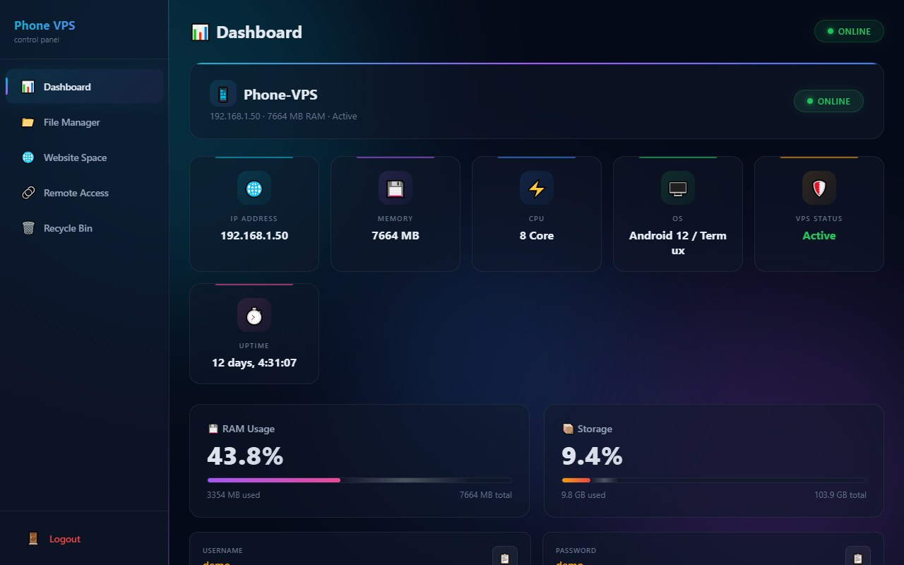
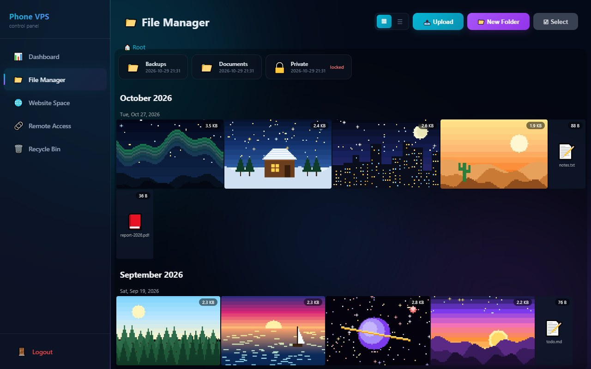
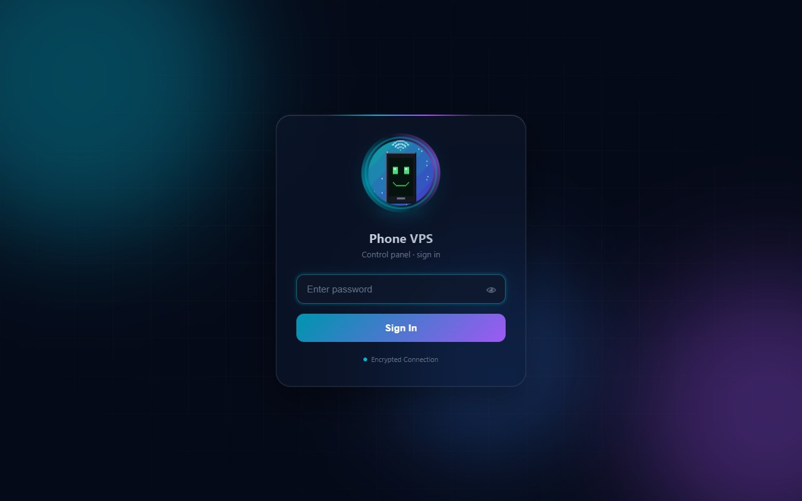
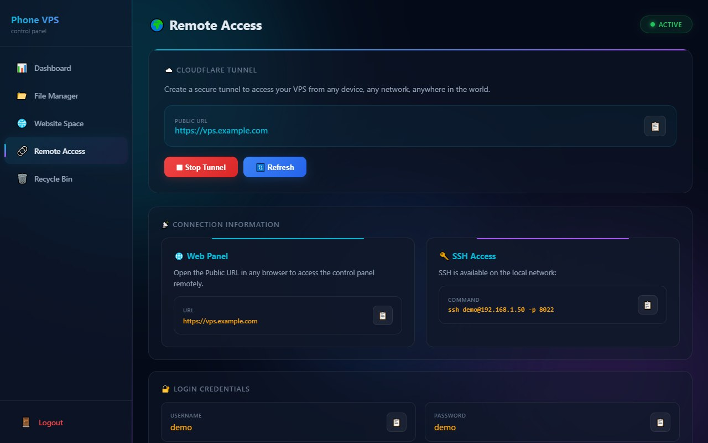
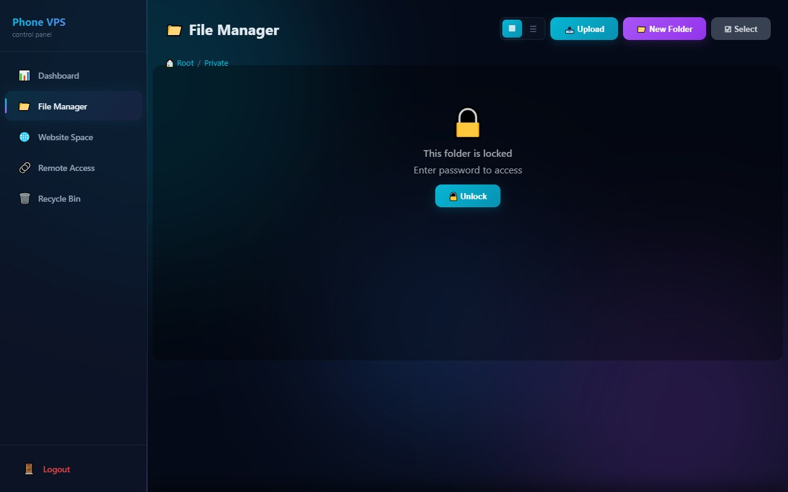
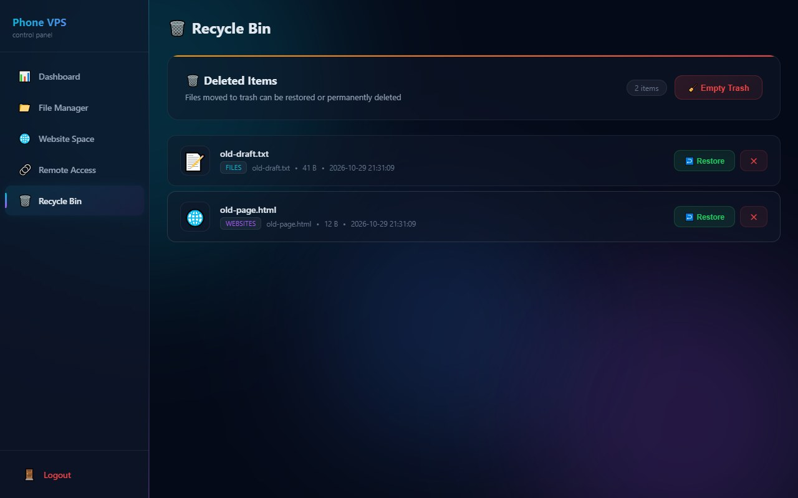
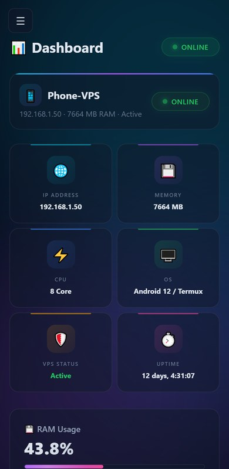

<p align="center">
  
</p>

```text
 ____  _                       __     ______  ____
|  _ \| |__   ___  _ __   ___  \ \   / /  _ \/ ___|
| |_) | '_ \ / _ \| '_ \ / _ \  \ \ / /| |_) \___ \
|  __/| | | | (_) | | | |  __/   \ V / |  __/ ___) |
|_|   |_| |_|\___/|_| |_|\___|    \_/  |_|   |____/

   an old Android phone  ->  a self-healing, always-on home server
```

<p align="center">
  <b>I turned a retired Sony Xperia 5 II — green line across the screen and all — into a 24/7 mini server<br>
  with a web control panel, a Google-Photos-style file manager, static-site hosting and a permanent HTTPS address.</b>
</p>

<p align="center">
  
  
  
  
  
  
</p>

---

## 🕹️ The idea

A phone is a surprisingly good server: 8 CPU cores, 7.5 GB of RAM, 100 GB of storage, a built-in battery that acts as a UPS and
a Wi-Fi radio — and mine was sitting in a drawer with a broken screen. So I gave it a second life:

```text
        you (any browser, anywhere)                    your home
      +----------------------------+          +----------------------------------+
      |  laptop / phone / tablet   |          |  OLD ANDROID PHONE   (Termux)    |
      +-------------+--------------+          |                                  |
                    | https                   |   Flask panel   :5000 --+        |
                    v                         |   file server   :8080 --+-> ~/vps|
      +----------------------------+  tunnel  |   sshd          :8022 --+        |
      |  Cloudflare edge           |<---------+-- cloudflared  (outbound only)    |
      |  https://vps.example.com   |          |                                  |
      +----------------------------+          |   watchdog.sh  - looks every 30s |
                                              +----------------------------------+
        no port forwarding - no static IP - no public inbound ports
```

- **Everything is reachable from anywhere** through a Cloudflare *named* tunnel — the phone only makes *outbound* connections, so it works
  behind any router or NAT.
- **It heals itself.** Power cut, crashed service, dropped internet — the phone brings everything back without anyone touching it.
- **Nothing to buy.** An old phone, a charger and a free Cloudflare account.

---

## 📸 Screenshots

<sub>Taken from the built-in demo (`python demo.py`): the real panel on sample data. The "photos" are pixel art generated for the demo by `tools/make_pixel_art.py`.</sub>

<table>
  <tr>
    <td width="50%"></td>
    <td width="50%"></td>
  </tr>
  <tr>
    <td align="center"><sub><b>Dashboard</b> — live RAM / storage / CPU, SSH details, start-stop-reboot for every service</sub></td>
    <td align="center"><sub><b>File manager</b> — Google-Photos-style gallery, grouped by month and day</sub></td>
  </tr>
  <tr>
    <td width="50%"></td>
    <td width="50%"></td>
  </tr>
  <tr>
    <td align="center"><sub><b>Login</b> — a pixel-art phone that smiles at you</sub></td>
    <td align="center"><sub><b>Remote access</b> — tunnel status, public URL, SSH command</sub></td>
  </tr>
  <tr>
    <td width="50%"></td>
    <td width="50%"></td>
  </tr>
  <tr>
    <td align="center"><sub><b>Folder locks</b> — a locked folder asks for its own password, and stays open only for that browser tab</sub></td>
    <td align="center"><sub><b>Recycle bin</b> — deletes are never final until you say so</sub></td>
  </tr>
</table>

<p align="center"><br><sub>…and it is responsive, so the phone can manage itself.</sub></p>

---

## ✨ Features

<table>
  <tr>
    <td align="center" width="16%"><br><b>Control panel</b></td>
    <td align="center" width="16%"><br><b>Permanent URL</b></td>
    <td align="center" width="16%"><br><b>File manager</b></td>
    <td align="center" width="16%"><br><b>Folder locks</b></td>
    <td align="center" width="16%"><br><b>Recycle bin</b></td>
    <td align="center" width="16%"><br><b>Self-healing</b></td>
  </tr>
  <tr valign="top">
    <td><sub>Live system stats, one-click start / stop / reboot of SSH, HTTP, the panel, the tunnel and the watchdog.</sub></td>
    <td><sub>Cloudflare named tunnel: the same HTTPS address after every reboot, power cut or router change.</sub></td>
    <td><sub>Gallery with lightbox, drag-and-drop upload with per-file progress, speed and ETA, rename, bulk delete, HEIC photos shown as JPEG.</sub></td>
    <td><sub>Lock any file or folder with its own password; locks are inherited by everything inside and stay unlocked only for the current tab.</sub></td>
    <td><sub>Deleted items go to a bin with their original path, and can be restored (name clashes are handled) or purged.</sub></td>
    <td><sub>Watchdog restarts crashed services and the tunnel; boot script and wake-lock bring it all back after a power loss.</sub></td>
  </tr>
</table>

Also: a **website space** (`~/vps/www`, served on port 8080 and, without a login, under `/site/`) for hosting a static page or portfolio from the phone,
a **one-command self-healing deploy** from the PC, and a **post-deploy verification** script.

---

## 🧠 Engineering highlights

- **A deploy script that fixes things instead of failing.** `deploy.py` runs five phases — *connect → upload → fix → restart → verify*. It tries an ADB
  port-forward, then Wi-Fi, then sets ADB up and starts `sshd` itself; uploads only changed files over SFTP; removes stale remote files and bytecode; kills
  leftover tunnels; installs missing tools; and checks every service one by one, restarting what is down.
- **`cloudflared` on Android needed a trick.** Go binaries on Termux can read neither `/etc/resolv.conf` nor the CA bundle. The tunnel runs under `proot`
  with Termux's `resolv.conf` and `cert.pem` bind-mounted where Go expects them, with `--protocol http2` for stability.
- **A watchdog that knows the difference between "crashed" and "offline".** Every 30 s it restarts dead services; when the internet drops it leaves the
  local services alone and, once the connection is back, restarts the tunnel — at most once every 2 minutes, so a flickering Wi-Fi can't cause a restart storm.
- **Survives power cuts.** `Termux:Boot` runs the start script at boot; a wake-lock and a battery-optimisation whitelist keep Android from killing Termux.
- **Android quirks, handled.** `os.getloadavg()` and `/proc/loadavg` both fail on Termux, so the CPU load is recovered by parsing `uptime`; the uptime string is
  normalised the same way; the local IP is detected at start-up because DHCP keeps changing it.
- **A file manager built by hand.** Justified photo grid grouped by month and day, lightbox with keyboard navigation (images, video, audio, text, PDF), upload
  with speed and ETA computed from a moving average — all in plain JavaScript, no framework.
- **Safe by construction where it counts.** Every file path is normalised and checked against its base folder (path-traversal protection); deletes go to a
  recycle bin with metadata; folder locks are inherited by children.
- **Config from the environment.** The deploy tooling reads hosts, credentials and the tunnel token from environment variables — nothing secret lives in the code.

### Recovery, as a picture

```text
 power cut ........ phone boots --> Termux:Boot --> start.sh --> SSH, HTTP, panel, tunnel, watchdog up
 service crashes .. watchdog notices (<= 30 s) --> restarts just that service
 internet drops ... core services keep running locally; watchdog logs [NET] OFFLINE
 internet is back . watchdog restarts the tunnel (2-minute cool-down) --> same public URL again
```

---

## 🚀 Run it

### 1 · Try the panel on your PC (no phone needed)

```bash
pip install flask
python demo.py              # http://127.0.0.1:5055   password: demo
```

The demo runs the real panel on a throw-away folder with sample data and pretend phone statistics; buttons that would start or stop real services
just say "demo mode". Everything is deleted when you stop it.

### 2 · Put it on a real phone

1. On the phone install **Termux** and **Termux:Boot** (F-Droid), run `pkg install python openssh cloudflared proot`, set a password with `passwd`
   and start `sshd` (it listens on port 8022).
2. On your PC:

```bash
pip install -r requirements.txt

# ---- configuration: nothing secret is stored in the repository ----
export PHONE_SSH_USER=<termux user>      # `whoami` in Termux
export PHONE_SSH_PASS=<termux password>
export PHONE_SSH_HOST=<phone wifi ip>    # optional: skip it to deploy over USB / ADB
export PHONE_ADB_SERIAL=<serial>         # optional: from `adb devices`
export CLOUDFLARE_TUNNEL_TOKEN=<token>   # optional: Cloudflare Zero Trust -> Tunnels -> your tunnel
export PANEL_PUBLIC_URL=https://vps.your-domain.com

python deploy.py                         # upload, fix, restart, verify
python tools/verify.py                   # needs PHONE_HOST and PANEL_PASSWORD too; add --buttons to also test start-all / reboot
```

On Windows PowerShell use `$env:PHONE_SSH_USER = "..."` instead of `export`.
The panel's login password is **generated on first start** and printed once in `~/vps/logs/panel.log` (or set `PANEL_PASSWORD` before the first start).

---

## 🔐 Security notes

This is a hobby project that I use myself, and these are its honest limits:

- One shared password, no rate limiting on the login — put the panel behind **Cloudflare Access** (or another second factor) if it is exposed.
- The dashboard shows the SSH/panel credentials (convenient on a private box, not on a shared one), and folder-lock passwords are kept in
  `locks.json` next to their hash. Both are good candidates for hardening.
- `/site/` is public **on purpose** (it is the website space). Everything else needs the login.
- Paths are normalised and confined to their base folder, sessions are `HttpOnly` / `SameSite=Lax` and last 7 days.

---

## 📁 Project structure

```text
Phone-VPS/
├── demo.py              run the panel on your PC with sample data
├── deploy.py            self-healing deploy from the PC (ADB / SSH / SFTP)
├── tools/verify.py      post-deploy verification of every service
├── tools/make_pixel_art.py   generates the banner, icons, avatar and demo photos (Pillow)
├── panel/               everything that runs on the phone
│   ├── web.py             Flask control panel (auth, stats, files, locks, trash, tunnel)
│   ├── start.sh           boot all services    ·  stop.sh   stop them
│   ├── watchdog.sh        the 30-second self-healing daemon
│   └── templates/         dark-theme UI: dashboard, files, remote, trash, login
└── docs/
    ├── NOTES.md           design notes and changelog
    ├── images/            banner, icons, screenshots
    └── demo-assets/       the pixel-art "photos" used by the demo
```

---

## 👤 Author

**Tayb Hassan Shizan** — [github.com/shizan52](https://github.com/shizan52)

<p align="center"><sub>© 2026 Tayb Hassan Shizan. All rights reserved. The source is shared for portfolio and review purposes.</sub></p>
